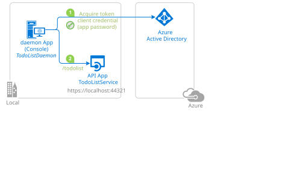

# Call Microsoft Graph and a custom API with client credentials

This chapter contains one daemon application with two executable call paths:

- `CallMicrosoftGraphAsync` calls Microsoft Graph `/users`.
- `CallCustomApiAsync` calls the included `TodoList-WebApi`.

Both calls use the same confidential client registration and credential from the `AzureAd` section. Their API-specific settings are separate: `MicrosoftGraph` and `TodoListApi`.



## Prerequisites

- [.NET 8 SDK](https://dotnet.microsoft.com/download/dotnet/8.0)
- A Microsoft Entra tenant
- A tenant administrator who can grant application permissions

## Choose the API registrations you need

Register the daemon application once. Configure a client secret for local development, or use another [Microsoft.Identity.Web client credential](https://aka.ms/ms-id-web/client-credentials), such as a certificate or workload identity.

### Optional: enable Microsoft Graph

Only complete these steps if you will run the `graph` or `all` target:

1. On the daemon app registration, add the Microsoft Graph **application** permission `User.Read.All`.
1. Grant tenant-wide admin consent.
1. Keep `MicrosoftGraph:Scopes` set to `https://graph.microsoft.com/.default`. For a national cloud, use that cloud's Microsoft Graph endpoint.

### Optional: enable the custom API

Only complete these steps if you will run the `custom-api` or `all` target:

1. Register `TodoList-webapi-daemon-v2`.
1. Set its Application ID URI to `api://<API_CLIENT_ID>`.
1. Expose an application role named `DaemonAppRole` with `allowedMemberTypes` set to `Application`.
1. Add that application permission to the daemon app registration and grant admin consent.
1. Configure `TodoList-WebApi/appsettings.json` with the tenant and API client ID.
1. Configure `TodoListApi:Scopes` in `daemon-console/appsettings.json` as `api://<API_CLIENT_ID>/.default`.

The scripts in `AppCreationScripts` create both registrations, add both the Graph and custom API application permissions, and update the local settings. If you only want one target, you can instead follow the relevant manual section above and omit the other permission.

## Configure the daemon

Edit `daemon-console/appsettings.json`:

```json
{
  "AzureAd": {
    "Instance": "https://login.microsoftonline.com/",
    "TenantId": "<TENANT_ID>",
    "ClientId": "<DAEMON_CLIENT_ID>",
    "ClientCredentials": [
      {
        "SourceType": "ClientSecret",
        "ClientSecret": "<CLIENT_SECRET>"
      }
    ]
  },
  "MicrosoftGraph": {
    "Scopes": [ "https://graph.microsoft.com/.default" ]
  },
  "TodoListApi": {
    "BaseUrl": "https://localhost:44372/",
    "RelativePath": "api/TodoList",
    "RequestAppToken": true,
    "Scopes": [ "api://<API_CLIENT_ID>/.default" ]
  }
}
```

Do not commit credentials. For production, prefer certificates, workload identity, or a secure credential store. [Chapter 3](../3-Using-KeyVault/README.md) shows the Key Vault certificate variation.

## Run

For Microsoft Graph:

```console
cd daemon-console
dotnet run -- graph
```

For the custom API, start the API first:

```console
cd TodoList-WebApi
dotnet run
```

Then, in another console:

```console
cd daemon-console
dotnet run -- custom-api
```

Run both configured targets sequentially with:

```console
dotnet run -- all
```

`all` is the default when no target is supplied.

## How it works

`TokenAcquirerFactory` loads the common confidential-client credential. `AddMicrosoftGraph` registers the Graph SDK client, while the named `TodoListApi` downstream API registration loads its own base URL, path, and scope. Each call acquires an app-only token for its configured resource.
